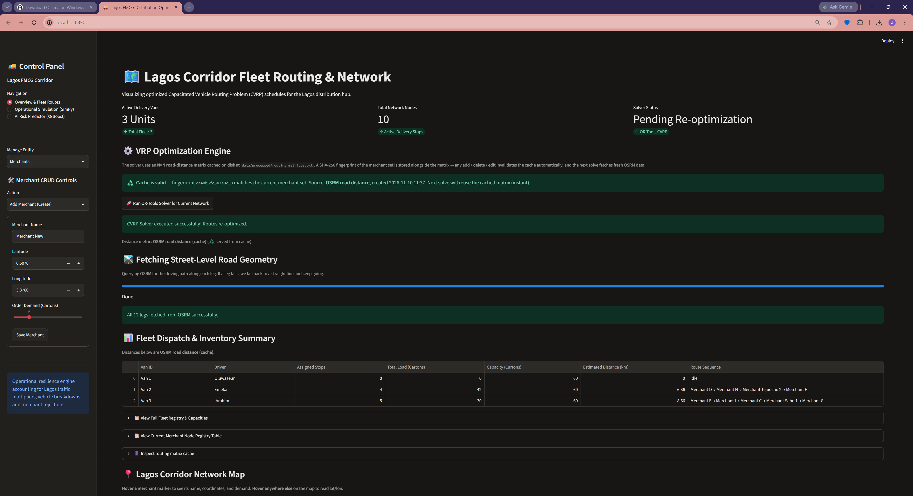
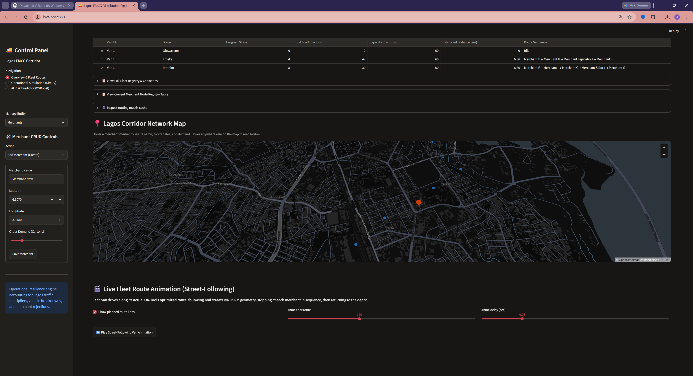
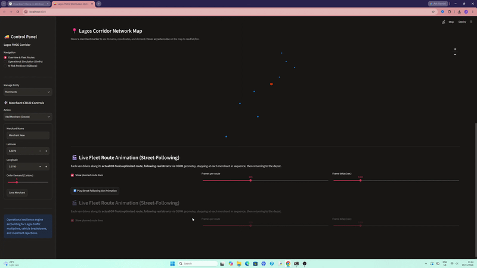
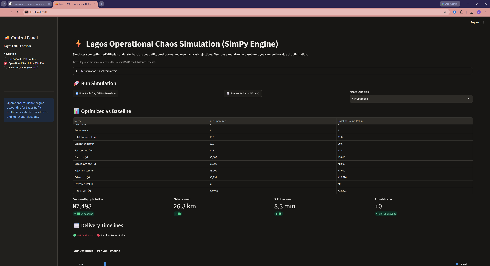
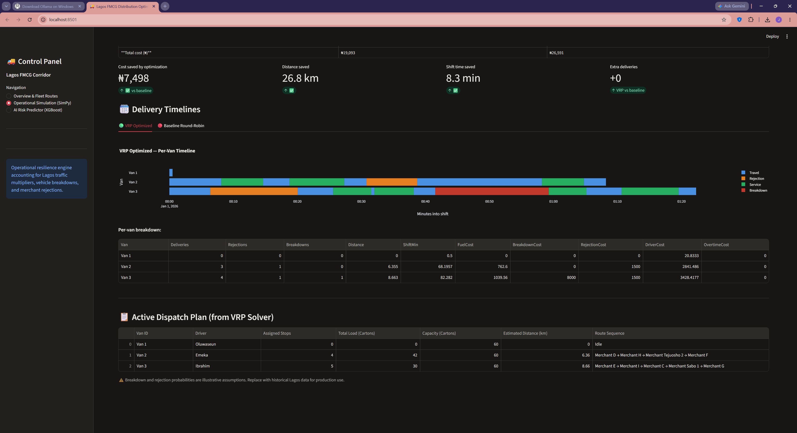
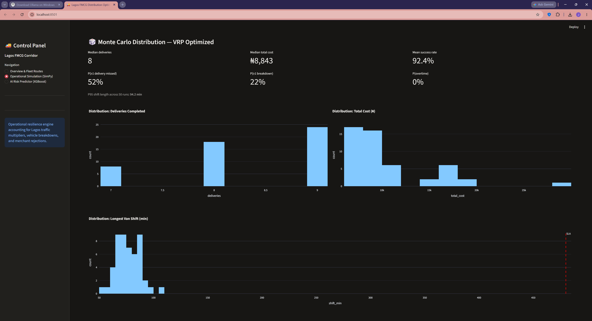
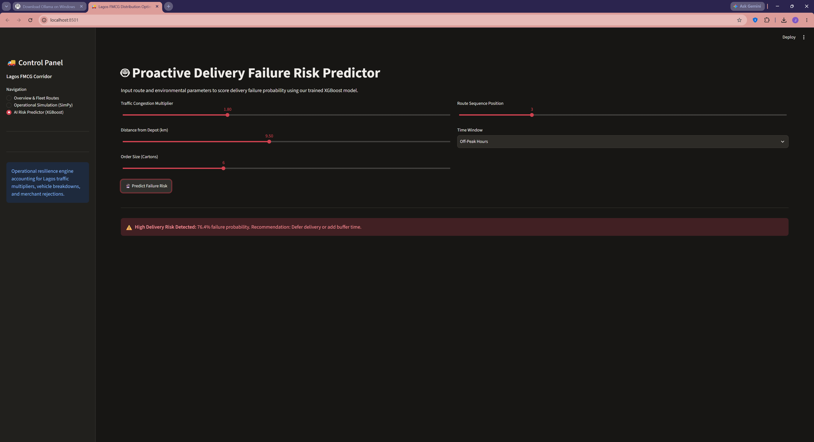
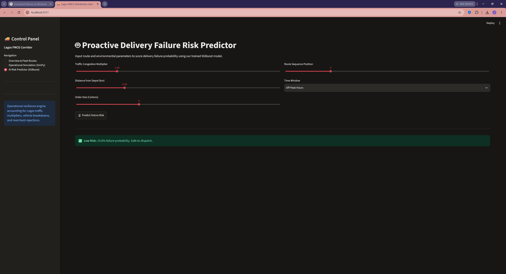

# 🚚 Lagos FMCG Distribution Optimizer

**A production-grade Streamlit application for optimizing last-mile FMCG distribution across the Yaba / Ikeja corridor in Lagos, Nigeria — from VRP route optimization and street-level animation to disruption simulation and AI-powered delivery risk scoring.**

[](https://www.python.org/)
[](https://streamlit.io/)
[](LICENSE)
[](https://developers.google.com/optimization)
[](http://project-osrm.org/)

---

## 📖 Overview

FMCG distributors in Lagos face a brutal operating environment: dense traffic gridlocks, frequent vehicle breakdowns, merchant cash-flow rejections, and a road network that makes straight-line distance meaningless. This project is a **decision-support tool** that combines four disciplines into one interactive application:

| Discipline | Tooling | Purpose |
|---|---|---|
| **Route Optimization** | Google OR-Tools | Solve Capacitated Vehicle Routing Problems (CVRP) against real road distances |
| **Geospatial Visualization** | PyDeck + OSRM | Render street-following route animations on interactive maps |
| **Discrete-Event Simulation** | SimPy | Model stochastic disruptions (breakdowns, rejections, traffic) and quantify plan resilience |
| **Predictive Risk Scoring** | XGBoost | Score the probability of delivery failure for any given route leg |

The app is designed for two audiences: **operations planners** who need to see and trust the optimized plan, and **data scientists / engineers** who want a reference implementation of an end-to-end decision pipeline.

---

## ✨ Key Features

### 🗺️ Overview & Fleet Routes
- **CVRP Solver** built on Google OR-Tools with capacity constraints per van
- **Real road-distance matrix** from the OSRM Table Service (one HTTP request for the whole N×N matrix)
- **Fingerprinted cache** — the distance matrix persists at `data/processed/routing_matrices.pkl` and auto-invalidates when the merchant set changes (SHA-256 fingerprint of name/coords/demand/type per row)
- **Interactive map** with live coordinate readout on hover
- **Street-following van animation** — each van drives along its actual OSRM-resolved polyline, stop-by-stop, and returns to depot
- **Graceful degradation** — falls back to haversine distance if OSRM is unreachable, and the UI truthfully reports which metric was used

### ⚡ Operational Simulation (SimPy)
- **VRP-driven** — simulates *your optimized plan*, not a round-robin guess
- **Distance-derived travel times** — leg duration = road_km / avg_speed × traffic_multiplier
- **Risk-proportional disruptions** — breakdown probability grows with cumulative km driven; rejection probability scales with order size
- **Full cost model** — fuel (₦/km), driver hours, overtime multiplier, breakdown incident cost, rejection handling cost
- **Side-by-side comparison** — VRP Optimized vs. Round-Robin Baseline with cost, distance, shift time, and deliveries
- **Gantt timelines** — per-van visualization of travel, service, breakdown, and rejection blocks
- **Monte Carlo mode** — 50 runs to produce distributions of deliveries, cost, and shift length with SLA line

### 🤖 AI Risk Predictor (XGBoost)
- Five-feature model trained on a weighted synthetic rule: traffic multiplier, distance from depot, order size, route position, and peak-hour flag
- Every slider has an observable effect on the predicted failure probability
- Threshold-based recommendation bands (Low / Moderate / High risk) with actionable guidance
- Heuristic fallback if the model file is missing

---

## 📸 Screenshots

> **Note to contributors:** replace the placeholders below with actual screenshots and GIFs. Recommended resolution: 1440×900 for static shots, ≤5 MB for GIFs. Store all images under `assets/` in the repo root.

### Overview & Fleet Routes


*The Overview tab after a successful solve. The dispatch table shows per-van routes, loads, and estimated road distance. The map shows all merchant nodes with hover coordinates.*

### Street-Following Van Animation

*A live recording of the animation — vans move along OSRM-resolved streets, stopping at each merchant in sequence, then returning to depot.*

### VRP vs Baseline Comparison

*After a single-day SimPy run, the app compares the optimized plan against a round-robin baseline across cost, distance, shift time, and deliveries.*

### Gantt Timeline

*Per-van timeline of a single simulated day. Blue = travel, green = service, orange = rejection, red = breakdown.*

### Monte Carlo Distribution

*Distribution of deliveries and total cost across 50 Monte Carlo runs, with SLA reference line.*

### AI Risk Predictor


*The XGBoost predictor scoring a route with moderate traffic and off-peak delivery window.*

---

## 🚀 Installation

### Prerequisites
- Python **3.10 or newer (python 3.14 was used for this project)**
- Internet access to `router.project-osrm.org` for road distances and street geometry
- A writable filesystem (for auto-generated model and routing cache)

### Setup

```bash
# 1. Clone the repository
git clone https://github.com/Webkingif/ai-unipod-lagos-fmcg-optimizer.git
cd ai-unipod-lagos-fmcg-optimizer

# 2. (Recommended) Create a virtual environment
python -m venv venv
source venv/bin/activate        # Linux / macOS
# venv\Scripts\activate         # Windows

# 3. Install dependencies
pip install -r requirements.txt
```

Run

```bash
streamlit run app.py
```

The app will open at http://localhost:8501.

### First-Run Behavior

On a fresh checkout with an empty `data/` folder, the app:

1. Auto-trains the XGBoost model (~2–3 s) and writes `data/models/risk_xgb_model.pkl`
2. Shows a banner indicating no routing cache exists yet
3. On your first solve, fetches an N×N distance matrix from OSRM and writes `data/processed/routing_matrices.pkl`

No manual setup, no `.env` file, no seed data required.

---

## 🗂️ Project Structure

```text
ai-unipod-lagos-fmcg-optimizer/
├── app.py                          # Main Streamlit application (single-file)
├── requirements.txt                # Pinned dependencies
├── README.md                       # This file
├── LICENSE                         # MIT
├── .gitignore                      # Excludes data/, venv/, __pycache__/, etc.
├── .streamlit/
│   └── config.toml                 # Optional: theme + server config
└── assets/                         # Screenshots and GIFs for this README
    ├── screenshot-overview.png
    ├── screenshot-animation.gif
    ├── screenshot-comparison.png
    ├── screenshot-gantt.png
    ├── screenshot-monte-carlo.png
    └── screenshot-risk.png
```

Auto-generated at runtime (excluded from git via `.gitignore`):

```text
data/
├── models/
│   └── risk_xgb_model.pkl          # XGBoost risk model (auto-trained)
└── processed/
    └── routing_matrices.pkl        # N×N road-distance matrix (auto-fetched)
```

---

## 🏗️ Architecture

### High-Level Data Flow

```text
              ┌─────────────────────┐
              │  merchants_df       │  ← Sidebar CRUD
              │  fleet_df           │
              └──────────┬──────────┘
                         │
                         ▼
              ┌─────────────────────┐
              │  OSRM Table Service │  ← 1 HTTP request → N×N matrix
              └──────────┬──────────┘
                         │
              ┌──────────▼──────────┐
              │  Fingerprinted      │  ← cached to disk, invalidated on
              │  distance matrix    │     merchant set change
              └──────────┬──────────┘
                         │
              ┌──────────▼──────────┐
              │  OR-Tools CVRP      │  ← routes per van
              └──────────┬──────────┘
                         │
              ┌──────────┴──────────┐
              │                     │
              ▼                     ▼
      ┌──────────────┐      ┌──────────────┐
      │ OSRM Route   │      │ SimPy        │  ← simulation uses the
      │ geometry     │      │ simulation   │     SAME distance matrix
      │ (per-leg)    │      │ (disruptions │     as the solver
      └──────┬───────┘      │  + costs)    │
             │              └──────────────┘
             ▼
      ┌──────────────┐
      │ PyDeck       │
      │ animation    │
      └──────────────┘
```

### Distance Metric — Critical Design Choice

The VRP solver uses real road distances, not haversine. This matters enormously in Lagos, where the lagoon, bridges, and one-way systems routinely cause straight-line distances to understate real driving distance by 30–50%.

- **Primary source:** OSRM Table Service (`/table/v1/driving/...?annotations=distance`)
- **Fallback:** Haversine if OSRM is unreachable or the network exceeds 100 nodes
- **Consistency:** The SimPy simulation reads the same matrix, so cost estimates reflect what the solver actually optimized for
- **Caching:** Matrix persists at `data/processed/routing_matrices.pkl` with a SHA-256 fingerprint of the merchant set; any add/edit/delete invalidates it automatically

### Why Two Caches?

| Cache | Scope | Invalidation |
|---|---|---|
| `@st.cache_data` on `fetch_osrm_distance_matrix` | Session-lifetime, in-memory | Streamlit restart or TTL expiry (24h) |
| `routing_matrices.pkl` on disk | Cross-session | Fingerprint mismatch → bypassed on next solve |

The in-memory cache handles rapid re-solves within a session. The disk cache handles cold starts. Both are safe to delete at any time.

---

## ⚙️ Configuration

All simulation and cost parameters are exposed in the Operational Simulation tab under **"Simulation & Cost Parameters"**:

| Parameter | Default | Meaning |
|---|---|---|
| Shift length | 480 min | Working-day SLA window |
| Avg driving speed | 18 km/h | Lagos inner-city average |
| Peak-hour multiplier | 2.4× | Traffic factor cap during peak hours |
| Service mean / std | 7 min / 2 min | Normal distribution for unloading time |
| Breakdown base prob | 0.02 | Flat component of breakdown risk per stop |
| Breakdown per-km prob | 0.005 | Additional breakdown risk per cumulative km driven |
| Rejection base prob | 0.05 | Flat component of rejection risk per stop |
| Rejection demand weight | 0.03 | Risk scaling per carton/20 order size |
| Driver cost | ₦2,500 / hr | Base wage |
| Overtime multiplier | 1.5× | Applied beyond shift length |
| Fuel cost | ₦120 / km | Per-km variable cost |
| Breakdown incident cost | ₦8,000 | Fixed cost per breakdown |
| Rejection handling cost | ₦1,500 | Fixed cost per rejected stop |

> ⚠️ **Note:** All disruption and cost parameters are illustrative assumptions. Replace with historical Lagos data for production use.

---

## 🔬 Methodology Notes

### VRP Solver
- **Algorithm:** OR-Tools `PATH_CHEAPEST_ARC` first-solution strategy + `GUIDED_LOCAL_SEARCH` metaheuristic
- **Time limit:** 3 seconds per solve
- **Constraints:** Per-van capacity from `fleet_df`, single depot
- **Objective:** Minimize total road distance across all vans
- **Fallback:** If the solver times out, a deterministic round-robin assignment is used (clearly labeled "Fallback" in the dispatch table)

### SimPy Simulation
- **Events:** Travel, breakdown, rejection, service — each with its own distribution and duration
- **Traffic:** Gamma-distributed multiplier, capped at the peak-hour parameter
- **Breakdown:** Bernoulli trial per stop with probability scaling with cumulative km
- **Rejection:** Bernoulli trial per stop with probability scaling with order size
- **Metrics captured:** Deliveries, rejections, breakdowns, distance, shift length, fuel cost, driver cost, overtime cost, breakdown cost, rejection cost

### XGBoost Risk Predictor
- **Training:** 3,000 rows of synthetic data generated from a weighted risk rule (traffic 35%, distance 20%, demand 15%, position 10%, peak 20%) + Gaussian noise
- **Features:** `traffic_multiplier`, `distance_to_depot`, `demand_cartons`, `route_position`, `is_peak_hour`
- **Model:** `XGBClassifier(n_estimators=120, max_depth=4, learning_rate=0.08)`
- ⚠️ **Important:** The model is trained on a synthetic rule, not real historical delivery failures. It demonstrates the pipeline and correctly responds to all five input features, but the absolute probability values are illustrative. Replace `y` in `ensure_model_exists()` with real labels for production use.

---

## ⚠️ Limitations & Known Constraints

- **Public OSRM server** (`router.project-osrm.org`) is rate-limited and only appropriate for demo-scale networks. For production, self-host OSRM or use OpenRouteService with an API key.
- **Matrix size cap:** OSRM Table Service on the demo server accepts ~100 coordinates per request. Beyond that, the app falls back to haversine.
- **No time-window constraints:** The CVRP solver optimizes distance only. Adding time windows (`AddDimension` with `Cumul` transit) would be a natural extension.
- **Synthetic risk labels:** See the XGBoost section above.
- **Single depot:** The solver assumes one central hub. Multi-depot is supported by OR-Tools but not wired into this app.
- **No authentication:** This is a decision-support demo, not a multi-tenant product.

---

## 🧪 Testing the App

### Smoke test after a fresh clone

```bash
streamlit run app.py
# → Overview tab loads, no errors, model auto-trains
```

### Verify the pipeline end-to-end

1. Open the **Overview & Fleet Routes** tab
2. Click **Run OR-Tools Solver for Current Network** — wait for green success banner
3. Confirm the caption shows *"Distance metric: OSRM road distance (🌐 fetched fresh from OSRM)"*
4. Confirm `data/processed/routing_matrices.pkl` now exists on disk
5. Click **Run OR-Tools Solver** again — caption should show *"♻️ served from cache"*
6. Add a merchant in the sidebar → re-solve → caption should show *"Cache bypass reason: Merchant set changed since last solve"*
7. Switch to **Operational Simulation** → run a single day → confirm Gantt charts render
8. Switch to **AI Risk Predictor** → adjust every slider → confirm the predicted probability changes for every input

---

## 🛠️ Development

### Recommended environment
- Python 3.14
- `venv` or `conda` for isolation
- Modern browser (Chrome / Firefox / Edge) — PyDeck requires WebGL

### Adding a new merchant manually (outside the UI)
Edit the initial `merchants_df` block in `app.py`. The next solve will auto-detect the change via fingerprint mismatch.

### Retraining the XGBoost model

```python
# Add a call in app.py:
ensure_model_exists(force_retrain=True)
```

Or delete `data/models/risk_xgb_model.pkl` and restart.

### Clearing all caches

```bash
rm -rf data/
```

The app regenerates everything on next run.

---

## 🤝 Contributing

Contributions are welcome. For substantial changes, please open an issue first.

1. Fork the repo
2. Create a feature branch: `git checkout -b feature/my-feature`
3. Ensure your changes don't break the smoke test
4. Add screenshots to `assets/` if your change is visual
5. Submit a pull request with a clear description

### Style
- PEP 8 for Python
- Comments for non-obvious logic
- Every `st.warning` / `st.info` / `st.error` should be actionable

---

## 📄 License

This project is licensed under the MIT License — see [LICENSE](LICENSE) for details.

You are free to use, modify, and distribute this code for commercial or non-commercial purposes with attribution.

---

## 🙏 Acknowledgements

- **Google OR-Tools** — CVRP solver
- **OSRM** — road-distance matrix and route geometry
- **Streamlit** — app framework
- **PyDeck** — geospatial visualization
- **SimPy** — discrete-event simulation
- **XGBoost** — gradient boosting

---

## 📬 Contact

For questions, feature requests, or collaboration:

- Open an issue on GitHub
- Reach out at `idowuoluwafemiayomide@gmail.com`
- Connect on https://www.linkedin.com/in/oluwafemi-idowu-ayomide

---

<p align="center">
  <sub>Built with 🚚 for the Lagos last-mile logistics community</sub>
</p>
